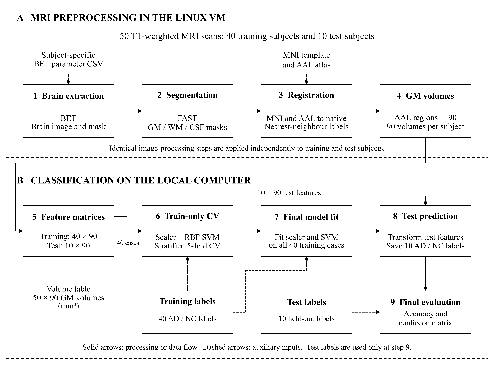
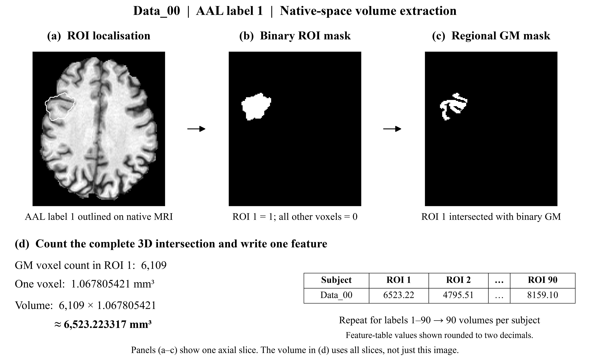

# Project01: MRI-based AD/NC classification

[English](README.md) · [中文版](README_zh-CN.md)

ELEC5622 Project01 extracts grey-matter volumes from the first 90 AAL regions and classifies Alzheimer's disease (AD) versus normal controls (NC). This repository contains the completed VM preprocessing, an executed SVM notebook, the submission volume table, and supporting figures and verification records.

The fixed baseline is `StandardScaler + SVC(kernel="rbf", C=1, gamma="scale")`. Parameters were not selected using test labels or test accuracy.

## Final report

[Download the final academic report (Word)](submission/ELEC5622_Project01_Academic_Report_BW.docx). The 17-page report includes methods, results, team contributions, references, and reproducibility appendices. Figure 1 on page 3 is the black-and-white workflow below. Section 3.6 and Figure 2 on page 5 explain regional GM volume extraction using actual Data_00 masks. Download the `.docx` file to read it in Word.

## End-to-end project workflow

The project converts each MRI into **90 regional grey-matter volumes**, then uses those numbers to learn an AD/NC classifier. The black-and-white figure separates Linux VM preprocessing from local classification. Solid arrows show processing or data flow; dashed arrows show auxiliary inputs. Test features bypass model fitting, and test labels enter only at final evaluation.



[Full-resolution PNG](report_evidence/figures/project_workflow_bw.png) · [Vector SVG](report_evidence/figures/project_workflow_bw.svg) · [Detailed workflow with scripts and outputs](report_evidence/figures/project_workflow_en.png) · [中文流程图](README_zh-CN.md#整体原理与步骤流程)

- Process all **50 MRI scans**; extract 90 GM volumes per subject.
- Use **40 subjects and their labels** for training-only validation and fitting the scaler/SVM.
- Apply the fitted model to the **10 test subjects**, save AD/NC predictions, then compare test labels for final evaluation.
- Run the four main preprocessing scripts in order: `SkullStripping` → `TissueSegmentation` → `Registration` → `Measurement`. `Measurement` calls `CreateSeedMask` automatically.
- Submit the **50 × 90 volume workbook** and a report describing the methods, figures, predictions, results, and limitations.

## From a brain region to one volume feature



For Data_00, AAL label 1 contains **6109 GM voxels**. Multiplying by the native voxel volume, approximately **1.067805421 mm³**, gives **6523.223317 mm³**, matching `ROI_1_mm3` in the training CSV. The pictures show one slice; the count uses the complete 3D masks. Repeat for labels 1–90 to produce each subject's feature row.

[Full-resolution PNG](report_evidence/figures/roi_volume_extraction_Data_00.png) · [SVG](report_evidence/figures/roi_volume_extraction_Data_00.svg) · [Source data and numerical check](report_evidence/figures/roi_volume_extraction_Data_00.json) · [Figure-generation code](report_evidence/figure_code/make_roi_volume_extraction.py)

## Repository contents

| Location | Contents |
| --- | --- |
| [Final report](submission/ELEC5622_Project01_Academic_Report_BW.docx) | Final 17-page academic report with the black-and-white workflow, illustrated ROI volume extraction, experimental figures, predictions, references, and appendices |
| [Project01_SVM.ipynb](Project01_SVM.ipynb) | Executed notebook with English explanations, following the Lab 2 load/split/train/predict/evaluate structure |
| [project01_svm.py](project01_svm.py) | CLI training and prediction, optional final evaluation, and shared notebook helpers |
| [Running guide](RUNNING_GUIDE.md) | Environment setup, VSCode instructions, and correspondence with Lab 2 |
| [Run results](RUN_RESULTS.md) | Actual metrics and predictions for all 10 test subjects |
| [data/](data/) | Training/test volume CSVs and the supplied label table |
| [Submission volume table](submission/Project01_90_ROI_GM_volumes.xlsx) | Train/Test worksheets covering all 50 subjects and 90 ROI volumes each |
| [results/](results/) | Saved predictions, evaluation, confusion matrix, training record, and fitted model |
| [Preprocessing](preprocessing/README.md) | Five Bash scripts, final BET parameters, all 698 VM output files, and SHA-256 checksums |
| [Report evidence](report_evidence/README.md) | 100 BET figures, 100 tissue/registration figures, review figures, workflow/CV plots, and execution logs |

## Data and methods

- Training: Data_00–Data_39, 40 subjects (NC 21 / AD 19). Test: Data_40–Data_49, 10 subjects (NC 4 / AD 6).
- Each subject has 90 binary grey-matter volumes, in mm³, for AAL labels 1–90. Each feature CSV has 91 columns: `FileName` and `ROI_1_mm3`–`ROI_90_mm3`.
- Labels are joined by `New Name`, with whitespace and NIfTI suffixes removed. NC=0 and AD=1. IDs, original names, and labels are excluded from the features.
- BET and FAST run in Linux. MNI template/atlas registration is from template space to each subject's native space; AAL labels use nearest-neighbour interpolation.
- The scaler is fitted on training data only. Five-fold stratified CV fits the complete pipeline separately within each fold; the final model is then fitted on all 40 training subjects.
- Test labels are used only after fitting and saving predictions. All 4500 measured volumes have been independently checked against the masks.

## Run the SVM locally

Verified with Python 3.12. Clone the repository, enter its root, and install the pinned dependencies:

```powershell
git clone https://github.com/Babe153/Project01_5622.git
cd Project01_5622
py -3.12 -m venv .venv
.\.venv\Scripts\python.exe -m pip install -r requirements.txt
.\.venv\Scripts\python.exe project01_svm.py --evaluate
```

With another supported Python installation, use `python -m venv .venv`. Alternatively, open the repository folder in VSCode, select this environment as the notebook kernel, and run `Project01_SVM.ipynb` from top to bottom. FSL is not required for the local SVM stage.

Omit `--evaluate` to fit and save predictions without comparing test labels. Rerunning updates `results/`. See the [English running guide](RUNNING_GUIDE.md) for details.

## Verified results

- Training accuracy: 100% (fit on the training data).
- Training-only five-fold CV: mean accuracy 97.5%, fold standard deviation 5 percentage points.
- Test accuracy: 90%, or 9/10 correct. Data_49 is predicted NC but has the supplied AD label.
- AD sensitivity: 83.3%; NC specificity: 100%.
- Notebook and CLI predictions/CV scores agree; reloading the saved model reproduces predictions.

See [English run results](RUN_RESULTS.md) and [test predictions](results/test_predictions.csv). These are fixed-baseline results on a small coursework dataset. Data_44 retains the agreed BET result and its known boundary limitations, documented in [processing QC records](submission/processing_qc_records.csv). No claim of globally optimal parameters or performance in other populations is made.

Browse all subjects directly in the [preprocessing image gallery](preprocessing/figures/README.md). The preprocessing README now embeds BET, FAST, and registration examples.

## View preprocessing and prepare the report

PNG figures can be previewed on GitHub. Download `.nii.gz` files and inspect them in FSLeyes. After downloading the repository, open the HTML browsers in `report_evidence/bet/` and `report_evidence/tissue_registration/` to switch between subjects offline. The preprocessing outputs alone occupy approximately 623 MiB.

Start with the [English report evidence index](report_evidence/README.md), which maps figures and records to the Methods, Results, and Discussion sections. Original MRI inputs, course PDFs, templates, and software installers remain in the original course materials.

## Chinese documentation

- [中文主页](README_zh-CN.md)
- [中文运行指南](README_运行说明.md)
- [中文运行结果](运行结果说明.md)
- [中文报告素材索引](report_evidence/README_zh-CN.md)

API references: [SVC](https://scikit-learn.org/stable/modules/generated/sklearn.svm.SVC.html), [Pipeline and data leakage](https://scikit-learn.org/stable/common_pitfalls.html).
