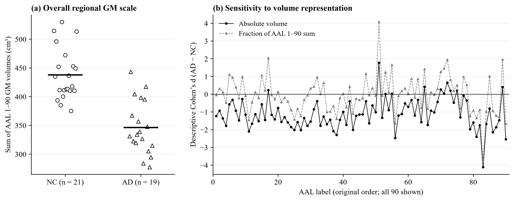

# Training feature description

This post hoc supplement examines only the 40 training subjects (21 NC, 19 AD). It was added after the original classification results to investigate overall GM volume, regional composition and stored image geometry. It does not select ROIs, refit models or read the test feature CSV. The original SVM settings and predictions remain unchanged.

## Findings

| Measurement | NC mean ± sample SD | AD mean ± sample SD |
| --- | --- | --- |
| Complete binary GM mask volume (cm³) | 604.8 ± 58.2 | 474.4 ± 58.6 |
| Sum of AAL labels 1–90 GM volumes (cm³) | 437.8 ± 44.6 | 346.4 ± 46.9 |

The mean AAL sum is 20.9% lower in AD. Of the 90 AD-minus-NC Cohen's d estimates, 79 are negative for absolute volumes and 48 for fractions of each subject's AAL sum; 31 change sign. Median absolute d changes from 1.22 to 0.66. All 90 labels are shown in their original order, with no selection or significance tests.

All 21 NC training masks have a 256 × 256 × 176 grid with 1 × 1 × 1 mm voxels. All 19 AD training masks have a 256 × 256 × 166 or 170 grid with non-isotropic voxels, approximately 0.94 × 0.94 × 1.20 mm. These class-associated geometries motivate scrutiny of acquisition and processing differences. The headers do not establish scanner or site provenance, and this audit does not demonstrate that geometry caused the classifier predictions.



## Files and reproduction

- [Summary and input hashes](summary.json)
- [Subject volumes](subject_summaries.csv)
- [All 90 regional effect contrasts](regional_effects.csv)
- [Training header audit](training_geometry.json), including a hash of each native mask's header
- [Figure PNG](training_volume_sensitivity.png) and [vector SVG](training_volume_sensitivity.svg)
- [Analysis source](../figure_code/analyse_training_volumes.py)

In an environment with the repository plotting dependencies and `nibabel`, run from the repository root:

```sh
python report_evidence/figure_code/analyse_training_volumes.py
```

The script joins labels by subject ID. Cohen's d uses the sample-size-weighted pooled within-class SD: `sqrt((18*s_AD^2 + 20*s_NC^2)/38)`. The denominator for each regional fraction is that subject's sum of the 90 regional volumes.

## Interpretation limits

The AAL sum and complete binary GM volume are not intracranial volume (ICV). Regional fractions share a denominator and sum to one; a positive relative difference does not demonstrate tissue growth. Neither the group contrasts nor their changes estimate SVM feature importance, causal disease effects or the performance of a different classifier. Totals and regional volumes retain the BET, segmentation and registration limitations of the original measurements.

[Voevodskaya et al. (2014)](https://www.frontiersin.org/journals/aging-neuroscience/articles/10.3389/fnagi.2014.00264/full) motivate evaluating the consequences of raw, proportional and residual volume representations. Their ICV adjustment differs from these GM-sum fractions. [TRIPOD+AI (2024)](https://www.bmj.com/content/385/bmj-2023-078378) informs transparent reporting of development and evaluation; it does not certify clinical usefulness or prescribe an adjustment strategy.
